# Ai-idiot-finance-tech-bro 久留美的AI煉股金融終端

繁體中文的個人金融終端機：台股、ETF、基金、美股、總經、匯率、重大事件一個畫面看完，右側 AI 側欄整合 TradingAgents、ai-hedge-fund、Qlib、FinRL、FinGPT、TimesFM、Laya 等開源專案，**所有 LLM 都跑在你自己的 Ollama**。同一套資料也能從 LINE／Signal（Hermes）和 Open WebUI 查詢。整套用 rootless Podman＋Quadlet 部署在一台 Linux 主機上。

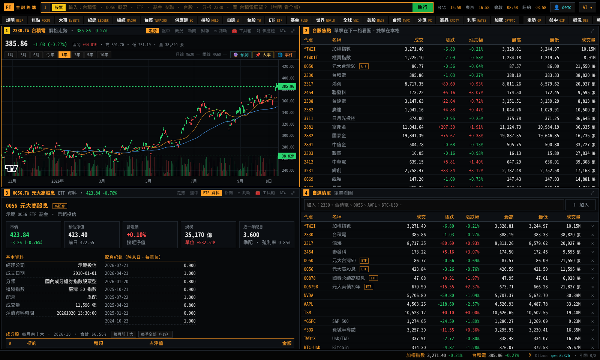

> 外觀參考 Bloomberg Terminal，但與 Bloomberg 無任何關聯，也沒有使用其資料或商標。AI 輸出僅供研究，不構成投資建議。
> 本頁截圖用內建的**示範資料模式**（`FT_FAKE_DATA=1`）產生，畫面上的數字不是真實行情。

**目錄**：[介面](#介面) · [功能導覽](#功能導覽) · [使用方式](#使用方式) · [資料來源](#資料來源) · [部署](#部署) · [開發](#開發與測試) · [變更紀錄](CHANGELOG.md)

---

## 介面

| 區塊 | 說明 |
|---|---|
| **指令列**（最上方） | 直接打中文或代號：`台積電`、`0056 概況`、`基金 安聯`、`分析 2330`、`問 台積電展望？`。打中文名稱會即時建議；開頭加 `1`–`4` 指定要開在哪一格（`2 鴻海 概況`）。 |
| **功能鍵列** | 常用頁面一鍵開啟：說明、焦點、大事、紀錄、總經、台經、產業、供應鏈、持股、自選、台股、ETF、基金、世界、全球、美股、台幣、外匯、商品、利率、加密，以及個股的走勢／盤中／概況／新聞／財報。 |
| **四格視窗** | 每格獨立，可放不同標的或頁面；點列表中的標的會在下一格開圖。每格右上 ⤢ 最大化。 |
| **AI 側欄**（右側） | TradingAgents、大師基金、Qlib、FinRL、FinGPT、TimesFM、Laya 判斷、策略回測、定期定額、ASK、設定。Ctrl+B 開關。 |
| **跑馬燈**（最下方） | 自選報價、Ollama 模型與引擎連線狀態。 |
| **登入**（右上 👤） | 「我的持股」與定期定額需要帳號；其他頁面不用登入。 |

- 台股慣用**紅漲綠跌**、成交量以**張**計（⚙ 設定可改國際綠漲紅跌）。
- 快捷鍵：Ctrl+1..4 切換視窗、Ctrl+B 開關側欄。
- 手機瀏覽會改成單欄：

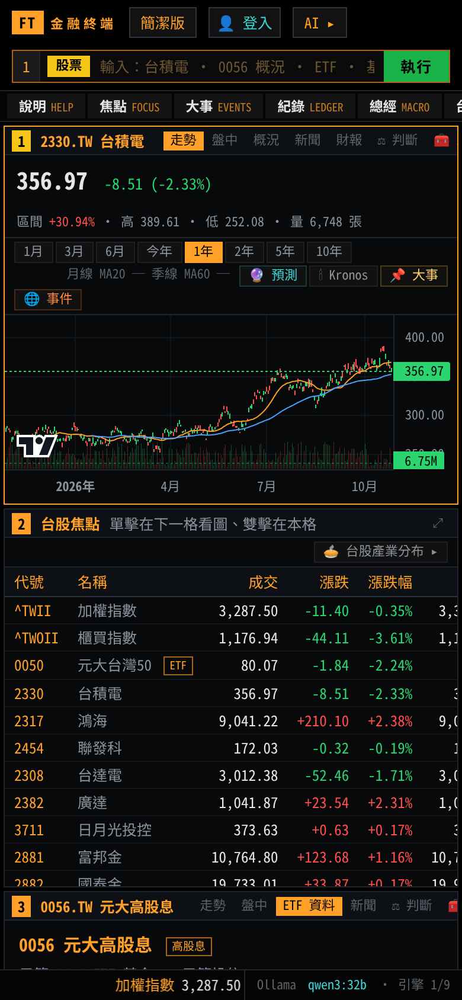

---

## 功能導覽

### 走勢圖：K 線＋重大事件＋預測

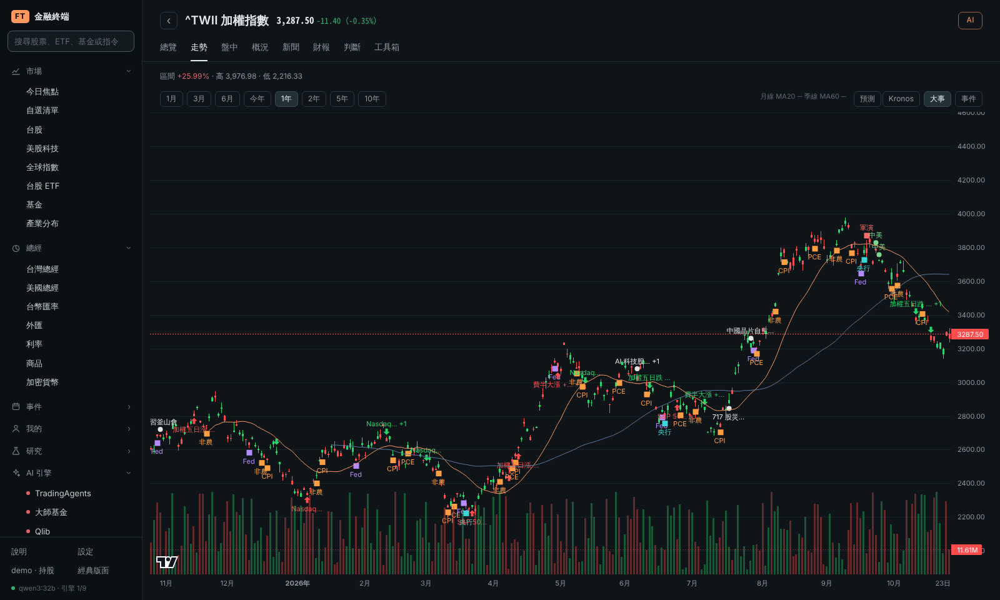

- 指令：`台積電`、`2330 走勢`、`^TWII`、`NVDA`；`2330 盤中` 看分時。
- 月線、季線、1 月～10 年區間；**📌 大事**：指數大波動、Fed 決策、台灣央行、美國 CPI／非農／PCE、中美談判、軍演、歷史大事（滑過看說明，點一下跳到「大事」頁）；**🌐 事件**：God's Eye View 偵測到的地震、軍機、航運異常。
- **🔮 預測**：TimesFM 畫出未來 10–120 個交易日的中位數與 80% 區間。
- 每格的功能列：概況、新聞、財報（台股＋美股 SEC 原始申報）、⚖ 判斷（Laya）、🧰 工具箱、⛓ 供應鏈、AI▸。

### 台股 ETF 與基金

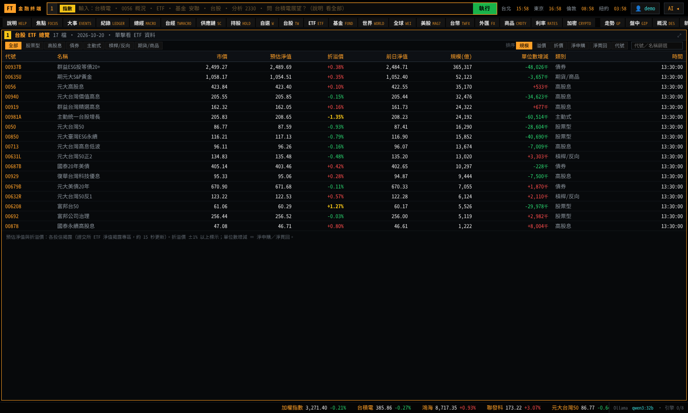

- `ETF`：全部上市櫃 ETF 的市價、**投信預估淨值**、**折溢價**（±1% 標黃）、規模、**單位數增減**（淨申購／買回），依股票型／高股息／債券／主動式／槓反／期貨篩選排序。
- `0056 概況`：配息紀錄、殖利率、**前十大成分股**／每季全部持股。

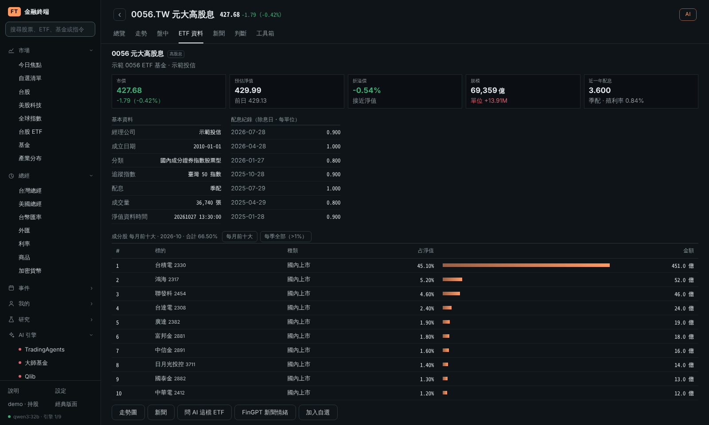

- `基金 安聯 台灣科技`：境內、境外、期信基金搜尋，淨值走勢與 1 週～3 年報酬。官方資料只給近期淨值，本機每天累積，境外基金另以 ISIN 補長期歷史。

### 今日焦點

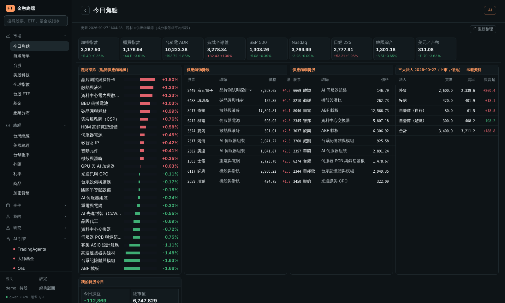

`焦點`：主要指數、題材（供應鏈環節）漲跌排行、供應鏈強勢／弱勢股、三大法人買賣超、今日新聞（自動標上相關題材）、登入者的持股今日損益；「🤖 AI 今日重點」由本機 Ollama 撰寫（不會讀任何人的持股）。

### 供應鏈地圖

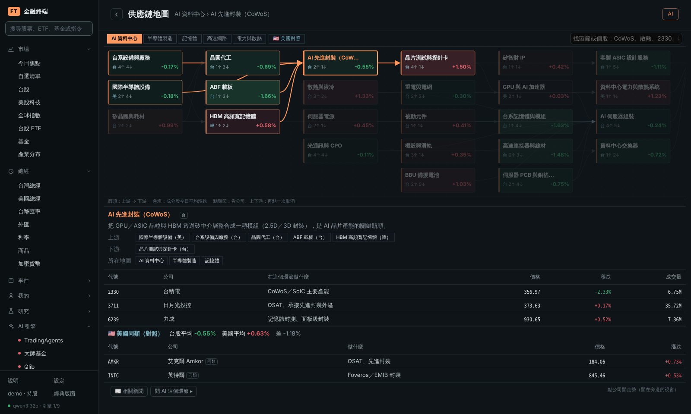

`供應鏈`、`供應鏈 CoWoS`、`供應鏈 奇鋐`：AI 資料中心、半導體製造、記憶體、高速網路、電力與散熱 5 張圖、25 個環節、約 120 家公司，色塊是成分股今日平均漲跌。點環節看上下游、公司在這個環節做什麼、即時價格；「🇺🇸 美國對照」比較同類美股。

### 重大事件

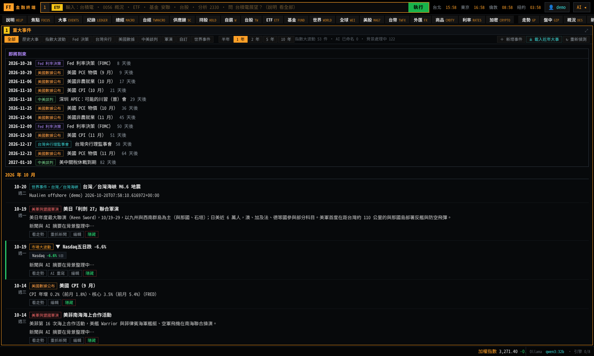

`大事`：依月份排列的市場時間線，上方「即將到來」列出接下來的日程。

| 類型 | 內容 |
|---|---|
| 指數大波動 | 加權、S&P 500、Nasdaq、費半的不尋常漲跌（相對近 60 日波動），美股與隔天台股反應合併成一件；自動抓當時新聞、本機 AI 命名與摘要 |
| 歷史大事 | 2020 年起 38 件（疫情股災、俄烏戰爭、SVB、DeepSeek、對等關稅、717 股災…） |
| Fed 決策 | 實際升降息（由 FRED 目標區間比對）；展開看**聲明稿逐句差異**、SEP 經濟預測、會議紀要與 AI 解讀 |
| 台灣央行、美國數據 | 理監事會日期；CPI、非農、PCE 公布日，公布後附實際數字 |
| 中美談判、軍演 | 關稅休戰與到期日、川習會、經貿會談；美軍與盟國聯合軍演（利劍、RIMPAC…） |
| 自訂、世界事件 | 自己新增的事件（可標未來日期）；God's Eye View 偵測的地震、氣旋等 |

每件都可編輯、隱藏、重抓新聞；你改過的標題與摘要永遠優先。

### 產業分布（美股、台股）

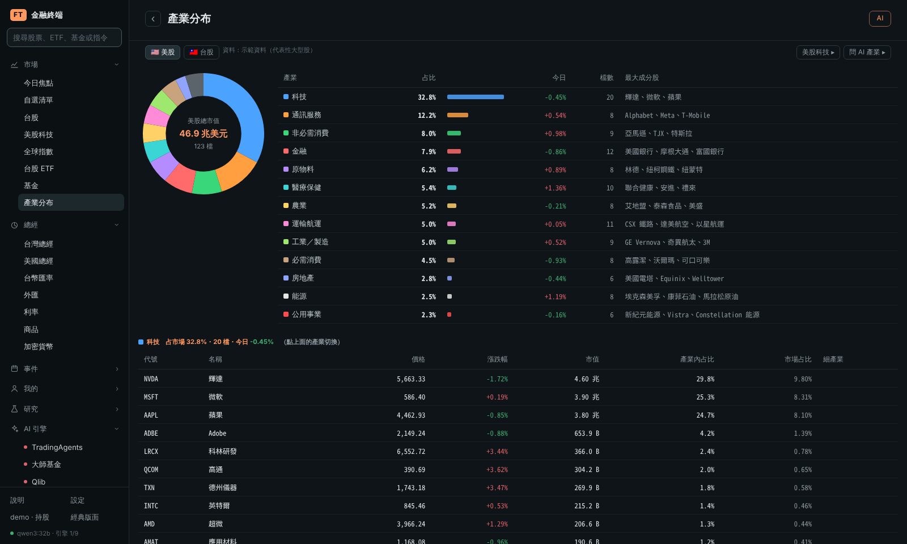

`產業`、`產業 美股`、`產業 台股`（或在「美股科技」「台股焦點」頁按「🥧 產業分布 ▸」）：各產業**市值占比圓餅圖**＋今日市值加權漲跌；點產業看成分股（價格、漲跌、市值、產業內占比、市場占比），單擊成分股在下一格看圖。
- 美股：Nasdaq 股票篩選器的全部上市股票，依科技、金融、醫療保健、非必需消費、通訊服務、工業／製造、必需消費、能源、原物料、公用事業、房地產分類，另把**運輸航運**（海運、貨運、鐵路、航空）和**農業**（農作物、農用化學、肉品、農機）獨立出來；同一家公司的多種股份（GOOG／GOOGL）只算一次。篩選器抓不到時改用內建約 130 檔代表性大型股估算，畫面會註明。
- 台股：上市＋上櫃普通股，證交所產業別（半導體、金融保險、航運、塑膠、鋼鐵、食品…），市值＝每日收盤價 × 發行股數。

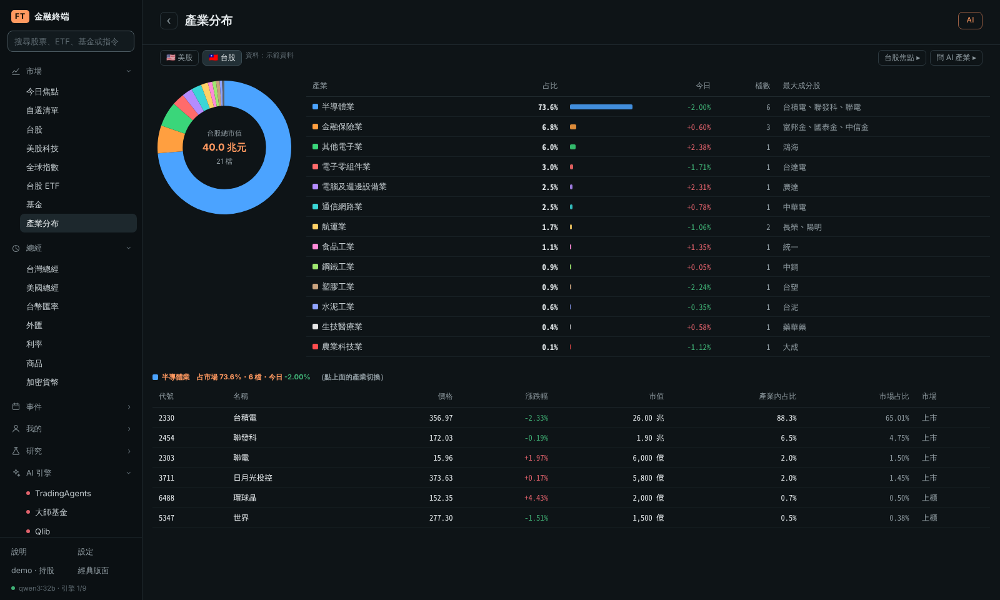

### 美國總經（FRED）

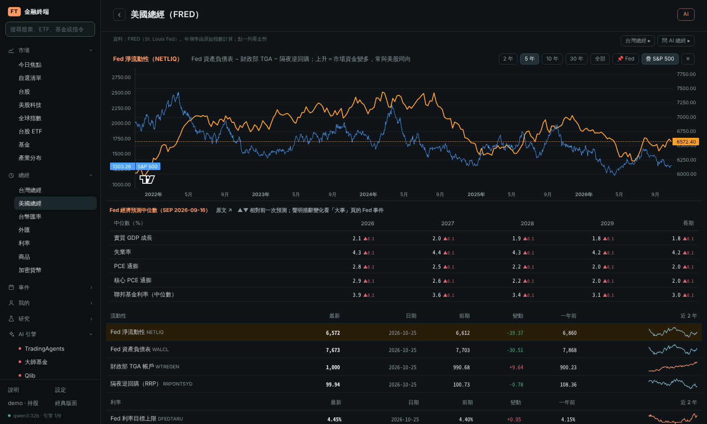

`總經`、`總經 DGS10`：Fed 淨流動性（資產負債表 − TGA − 逆回購）、利率與殖利率曲線、CPI／PCE、就業、GDP、信心、衰退機率、信用利差、VIX、美元、M2、油價；頂端是最新一次 Fed 經濟預測（SEP）中位數。點一列看長期走勢，可疊 S&P 500、標 Fed 升降息。

### 台灣總經

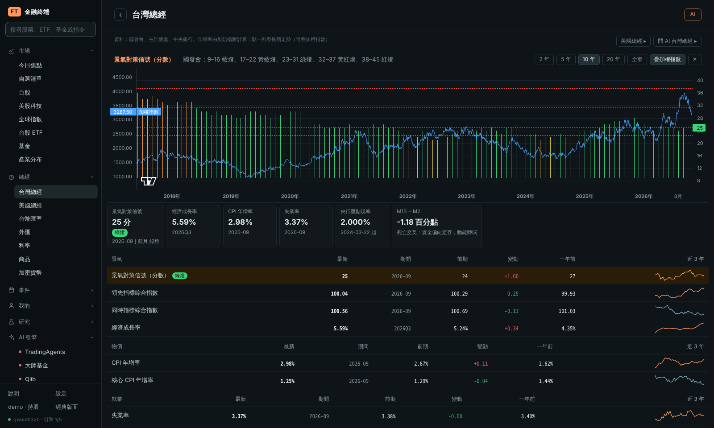

`台經`（`台灣總經`、`景氣燈號`）：國發會**景氣對策信號**（分數與燈號）、領先／同時指標、經濟成長率、CPI 與核心 CPI、失業率、央行重貼現率、隔夜拆款利率、M1B／M2 年增率與 **M1B − M2**。燈號以顏色長條呈現，可疊加權指數。資料來自國發會、主計總處、中央銀行；`/api/twmacro/diag` 顯示每項的來源與狀態。

### 台幣匯率

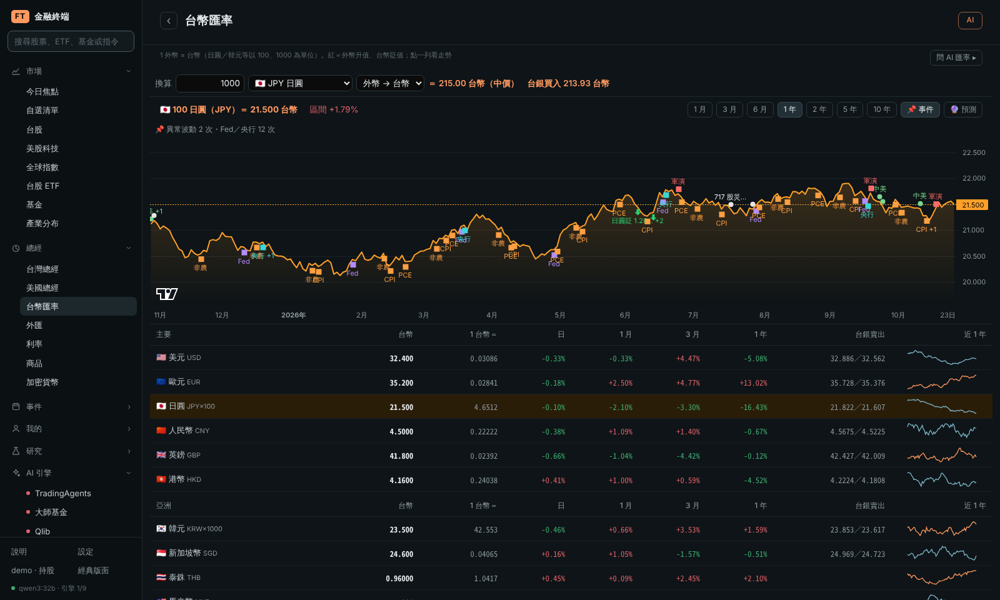

`台幣`、`匯率 日圓`：新台幣對 32 種貨幣（1 外幣＝台幣、日／月／年變動、台銀牌告、近一年走勢），換算器（中價＋台銀牌告價）。走勢圖標出**異常波動日**與 Fed／央行／中美事件，🔮 預測 1–6 個月區間。

### 分析工具箱

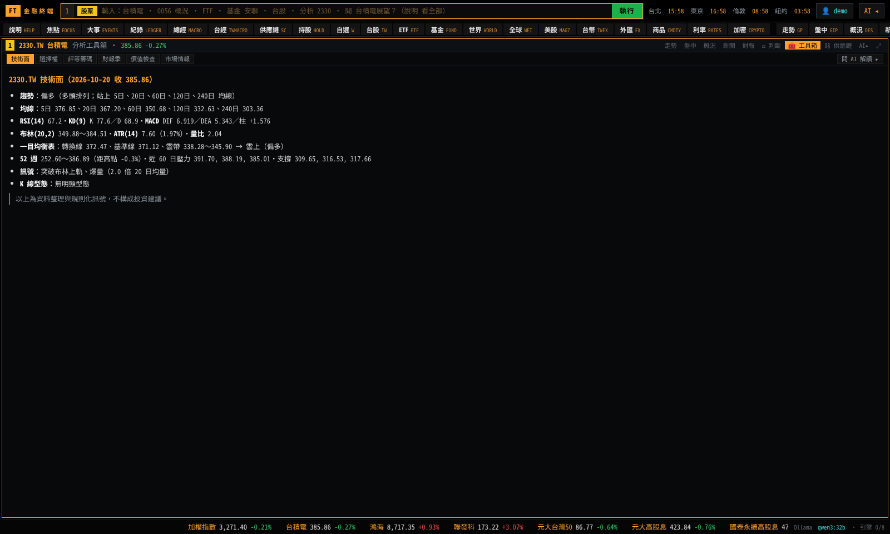

個股的「🧰 工具箱」或 `技術 2330`、`NVDA 選擇權`、`評等 2330`、`財報季 AAPL`、`價值 KO`、`情報`：技術面（均線、RSI、KD、MACD、布林、一目均衡表、型態、支撐壓力）、美股選擇權（IV、Greeks、Put/Call、max pain）、分析師評等與籌碼（台股三大法人、融資券）、財報季、價值檢查（Graham、NCAV、Piotroski）、市場情報（類股輪動、市場廣度）。全部本機計算，不需要券商帳戶。

### 我的持股與定期定額（需登入）

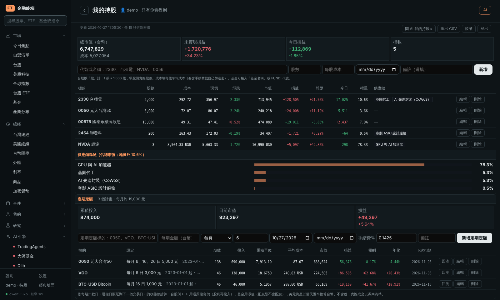

- 持股：即時市值、損益、報酬、今日損益、權重（外幣自動換台幣）、**供應鏈曝險**；匯出 CSV；「問 AI 我的持股」（只在當次對話，不存檔）。
- 定期定額計畫：台股、美股、ETF、基金、比特幣，每月幾號／每週／每日扣款，自動補算已扣過的期數，算平均成本、報酬、**年化（XIRR）**、下次扣款日。
- 隱私：每個帳號只看得到自己的資料；持股與計畫**不會**進 Obsidian、Hermes、Open WebUI、agent API 或 AI 工作紀錄。

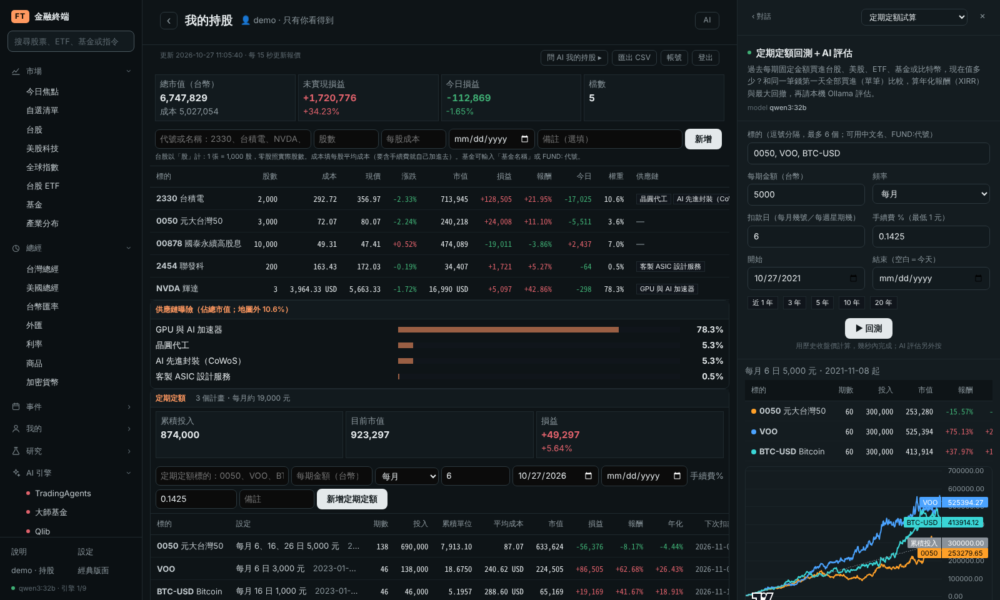

側欄 **📈 定期定額**（`定期定額 0050, VOO, BTC-USD`）：任何標的過去 1–30 年的定期定額績效，與同金額單筆投入比較，畫出市值與累積投入；「🤖 AI 評估」只根據回測數字撰寫。

### 其他頁面

| 頁面 | 指令 | 內容 |
|---|---|---|
| 世界事件 | `世界`、`上帝視角` | 整合 [God's Eye View](https://github.com/bilawalsidhu/gods-eye-view)：台海、南海、紅海、荷莫茲等區域的地震、軍機、船舶、氣旋讀數與 30 天事件，可開 3D 地球；這些訊號也會送進 TradingAgents 與 TimesFM |
| 策略研究 | `研究`、`選股 營收連續成長、投信在買` | 用中文描述選股想法，AI 轉成條件；或用 7 個內建策略。回測報告（年化、回撤、夏普、月報酬熱力圖）、今日選股名單、交易明細。資料（股價、估值、法人、融資券、月營收、季財報）從官方來源抓到本機，公布日對齊避免偷看未來 |
| 資料庫 | `資料庫` | 策略研究用的資料目錄、收集進度與錯誤 |
| 分析紀錄 | `紀錄`、`紀錄 2330` | 每次 AI 分析自動記錄，5／20／60 日後**自動核對**對錯與超額報酬；各引擎成績單；AI 檢討後把「給下次的提醒」帶回分析提示詞 |
| 監控表 | `台股`、`熱門ETF`、`全球`、`美股`、`外匯`、`商品`、`利率`、`加密`、`自選` | 報價列表，單擊在下一格看圖 |

### AI 引擎（右側欄）

| 分頁 | 上游 | 做什麼 |
|---|---|---|
| TradingAgents | [TauricResearch/TradingAgents](https://github.com/TauricResearch/TradingAgents) | 分析師團隊 → 多空辯論 → 交易員 → 風控 → 經理，5 級評等；流程儀表板顯示每個代理人的進度 |
| 大師基金 | [virattt/ai-hedge-fund](https://github.com/virattt/ai-hedge-fund) | 巴菲特、蒙格、葛拉漢、林區、杜肯米勒觀點；ETF 改評估前幾大成分股 |
| Qlib | [microsoft/qlib](https://github.com/microsoft/qlib) | Alpha158＋LightGBM 選股排名與回測（台股成本） |
| FinRL | [AI4Finance-Foundation/FinRL](https://github.com/AI4Finance-Foundation/FinRL) | 強化學習（PPO／A2C／SAC…）資產配置 vs 等權買進持有 |
| FinGPT | [AI4Finance-Foundation/FinGPT](https://github.com/AI4Finance-Foundation/FinGPT) | 下週走勢預測、新聞情緒（台股用中文新聞） |
| TimesFM | [google-research/timesfm](https://github.com/google-research/timesfm) | 時間序列基礎模型，零樣本預測價格、匯率、基金淨值＋回測（CPU） |
| Laya 判斷 | [receptron/laya](https://github.com/receptron/laya) | 一次推論給出買進／持有／觀望／賣出／放空的機率（CPU，非金融專用模型，請看命中率再參考） |
| ASK | 本機 Ollama | 問任何問題；自動帶入問題提到的標的、總經、匯率、事件、世界訊號等相關資料 |

**FT 市場背景**：分析開始前，終端機會把引擎本身讀不到的資料整理成一段送進去，且只取**分析基準日當天以前已公布的**（回測不會偷看未來）：

| 段落 | 內容 |
|---|---|
| 台股個股 | 中文新聞、三大法人與融資券、月營收、證交所本益比／殖利率／淨值比（含近一年百分位）、季財報、除權息 |
| 台股 ETF | 預估淨值、折溢價、規模、單位數增減、分類與追蹤指數、成分股權重、配息紀錄 |
| 美股個股 | 英文新聞、SEC 最近申報 |
| 今日（只在當日分析） | 所屬產業強弱與排名、供應鏈環節與上下游今日表現 |
| 市場 | 台灣總經、台幣匯率（美元、日圓、人民幣、歐元、韓元）、美國總經與 Fed 淨流動性、最近一次 FOMC 聲明措辭變化與 SEP、近 30 天大事（含中美、軍演）與接下來的日程 |
| 交叉參考 | 其他 AI 引擎近 30 天對同一檔的結論、世界訊號 |

TradingAgents 每個代理人都看得到；投資大師每位大師；FinGPT 的提示詞；Qlib／FinRL／TimesFM 的 Ollama 解讀；Laya 轉成英文狀態（台股中文新聞先由本機 Ollama 翻成英文）。引擎自己已經有的不重複送（例如 TradingAgents 的世界訊號與英文新聞、FinGPT 的新聞）。ASK 問到個股時也一律帶入這份背景（之前要出現「總經」「匯率」等字眼才會帶）。每個引擎的表單有「加入 FT 市場背景」可關閉；`/api/brief?s=2330` 預覽內容，執行紀錄與報告最後列出帶入了哪些段落。

完成的分析可自動寫成 Obsidian 筆記（`finance/AI 預測/`），並每天產生「AI 預測回顧」對答案。

---

## 使用方式

### 常用指令

| 指令 | 功能 |
|---|---|
| `台積電`、`2330`、`2330 走勢`、`NVDA`、`^TWII` | K 線走勢（中文名稱、代號、Yahoo 代號都可以） |
| `<標的> 盤中`／`概況`／`新聞`／`財報` | 分時、基本資料、新聞、財報（英文代碼 GIP／DES／N／FA 也可） |
| `ETF`、`0056 概況` | ETF 總覽、ETF 資料頁 |
| `基金 安聯 台灣科技` | 基金搜尋 → 淨值走勢與報酬 |
| `焦點`、`大事`、`紀錄` | 今日焦點、重大事件、AI 分析紀錄 |
| `總經`、`總經 NETLIQ`、`台經`、`台幣`、`匯率 日圓` | 美國總經、台灣總經、台幣匯率 |
| `供應鏈`、`供應鏈 CoWoS` | 供應鏈地圖 |
| `產業 美股`、`產業 台股` | 產業分布圓餅圖與成分股 |
| `持股` | 我的持股與定期定額（需登入） |
| `技術 2330`、`NVDA 選擇權`、`價值 KO`、`情報` | 分析工具箱 |
| `分析 2330`、`大師 AAPL`、`量化`、`強化學習 2330 2317`、`預測 NVDA` | 開啟 AI 分頁並帶入標的 |
| `判斷 台積電` | Laya 交易判斷 |
| `定期定額 0050, VOO` | 定期定額回測 |
| `研究`、`選股 營收連續成長、投信在買`、`資料庫` | 策略研究 |
| `世界` | 世界事件 |
| `問 0056 和 00878 哪個配息好？` | 問 AI |
| `2 鴻海 概況` | 開頭 1–4 指定視窗 |

完整說明在畫面上的 **說明（HELP）** 頁。

### Hermes（LINE／Signal）

```bash
./scripts/install-hermes-skill.sh
```

把 `hermes/fin-terminal/` 安裝成 Hermes skill（用 `podman unshare` 複製到 `~/.hermes/skills/`、實測一次、有變更才重啟 Hermes）。之後在 LINE／Signal 用自然語言問，Hermes 會呼叫 `ft.py`：

| 你說 | Hermes 執行 |
|---|---|
| 「台積電、0050 現在多少」 | `ft.py quote 台積電 0050` |
| 「大盤今天怎樣」「盤後簡報」 | `ft.py market`／`ft.py brief` |
| 「00878 折溢價和配息」「哪些 ETF 溢價最高」 | `ft.py etf 00878`／`ft.py etf-rank --sort premium` |
| 「台灣景氣燈號」「美國總經」「Fed 淨流動性」 | `ft.py twmacro`／`ft.py macro`／`ft.py liquidity` |
| 「美股各產業占比」「台股哪個產業權重最大」 | `ft.py sectors us`／`ft.py sectors tw` |
| 「中美談判進度」「最近有什麼軍演」 | `ft.py geo uscn`／`ft.py geo drill` |
| 「下週有什麼重要數據」「上次 Fed 聲明改了什麼」 | `ft.py calendar`／`ft.py fomc` |
| 「日圓匯率」「0050 定期定額 5 年績效」 | `ft.py twfx JPY`／`ft.py dca 0050 --years 5` |
| 「台積電技術面」「NVDA 選擇權」 | `ft.py tech 2330`／`ft.py options NVDA` |
| 「台積電該買還是賣」「0050 未來一個月預測」 | `ft.py decide 台積電`／`ft.py forecast 0050 --days 20` |
| 「找營收連續成長、投信在買的股票」 | `ft.py strategy "營收連續成長、投信在買"` |
| 「台海最近有什麼動靜」 | `ft.py world 台灣` |
| 「用 TradingAgents 分析 2330」 | `ft.py analyze tradingagents 2330`（沒跑完回 PENDING，再用 `ft.py job` 接著等） |

`ft.py` 只用 Python 標準函式庫，輸出純文字並截在 4500 字內（適合 LINE）。完整指令：`hermes/fin-terminal/scripts/ft.py --help`。

### Open WebUI

**Workspace → Tools → ＋**，貼上 `openwebui/ft_terminal_tool.py` 的內容並儲存；在模型設定（或對話的 ＋ 工具）勾選「FT Terminal 金融終端」，建議 Function Calling 設為 **Native**。Valves：`FT_URL`（預設 `http://127.0.0.1:8130`）、`MAX_WAIT`（AI 分析最多等幾秒）。**每次升級後要重新貼上**（看檔頭的 `version`）。

提供的工具：報價、個股、ETF、ETF 排行、基金、市場總覽、新聞、今日焦點、供應鏈、產業分布、重大事件、分析紀錄、美國總經、台灣總經、Fed 淨流動性、FOMC 文件、經濟日曆、中美談判／軍演、台幣匯率、技術面、選擇權、評等、財報季、價值檢查、市場情報、定期定額回測、SEC 申報、TimesFM 預測、Laya 判斷、選股、世界事件、預測回顧、啟動 AI 分析與取結果。

### Agent API

Hermes 與 Open WebUI 都是呼叫這組 API，你的腳本也可以：

```bash
curl localhost:8130/api/agent/help                       # 全部端點
curl 'localhost:8130/api/agent/quote?q=台積電,0050,AAPL'
curl 'localhost:8130/api/agent/twmacro?plain=1'          # plain=1 去掉 Markdown
curl 'localhost:8130/api/agent/etf/rank?sort=premium&format=json'   # format=json 拿資料
curl -XPOST localhost:8130/api/agent/analyze -H 'content-type: application/json' -d '{"engine":"tradingagents","q":"2330"}'
```

---

## 資料來源

全部是公開、免費的來源，大多不需要金鑰：

| 資料 | 來源 |
|---|---|
| 台股即時報價、加權／櫃買指數 | 證交所 MIS（約 5 秒） |
| 證券清單、公司資料 | 證交所 ISIN、證交所／櫃買 OpenAPI |
| ETF 預估淨值、折溢價、單位數 | 證交所 ETF 淨值揭露（約 15 秒） |
| ETF 成分股、基金淨值 | 投信投顧公會、集保結算所開放資料 |
| 三大法人、融資券、估值、月營收、季財報 | 證交所、櫃買、公開資訊觀測站 |
| K 線、海外市場、美股財報、交叉匯率 | Yahoo Finance（yfinance，延遲報價） |
| 美股官方申報 | SEC EDGAR（需設定 `FT_SEC_USER_AGENT`） |
| 美國總經、Fed 淨流動性 | FRED（St. Louis Fed） |
| FOMC 聲明、紀要、SEP | federalreserve.gov |
| 台灣總經 | 國發會（data.gov.tw）、主計總處 SDMX、中央銀行 |
| 台銀牌告匯率 | 臺灣銀行 |
| 新聞 | Google 新聞 RSS（中文、英文） |
| 世界訊號 | God's Eye View（地震、航班、船舶 AIS、氣旋、野火；船舶需 AISStream 金鑰） |

投信投顧公會頁面的解析移植自 [TWSEMCPServer](https://github.com/twjackysu/TWSEMCPServer)（MIT）。

---

## 部署

### 需求

| 項目 | 說明 |
|---|---|
| 作業系統 | Linux（開發與使用於 Arch Linux），systemd 使用者服務 |
| Podman | **rootless**，≥ 4.4（使用 Quadlet）；以一般使用者執行，不要用 root |
| Ollama | 預設 `http://127.0.0.1:11434`，需要一個支援 tool calling 的模型（預設 `qwen3:32b`，可在 ⚙ 設定或 env 改） |
| 硬體 | 建置約 15–25 分鐘；TimesFM、Laya、FinRL 跑在 CPU；記憶體建議 16 GB 以上；磁碟數十 GB（映像、模型權重、策略研究資料） |
| 選用 | Tailscale（tailnet HTTPS）、Cloudflare Tunnel（公開網址）、Obsidian vault、Hermes、Open WebUI |

讓服務開機自動啟動（不用登入）：

```bash
sudo loginctl enable-linger $USER
```

### 安裝

```bash
git clone https://github.com/yoshikigo/fin_terminal.git fin-terminal
cd fin-terminal
./install.sh                 # 建 8 個映像、安裝 Quadlet 單元與 Obsidian 搬運器、啟動
./tests/smoke.sh             # 用真實資料逐項檢查（報價、ETF、基金、總經、匯率、AI 引擎…）
```

裝好後打開 `http://127.0.0.1:8130`。第一次啟動會下載證券清單與基金淨值（約 1–2 分鐘）；TimesFM（約 0.8 GB）與 Laya（約 1.7 GB）的權重會在第一次使用時從 Hugging Face 下載；策略研究的歷史資料在背景回補（月營收、財報約 1 小時，日資料數小時）。

`install.sh` 選項：

| 指令 | 用途 |
|---|---|
| `./install.sh terminal` | 只重建終端機（UI、資料層、FinGPT、策略研究）；多數升級只需要這個 |
| `./install.sh tradingagents hedgefund` | 只重建指定引擎（`gev terminal tradingagents hedgefund qlib finrl timesfm laya`） |
| `./install.sh --no-build` | 只重新安裝 Quadlet 單元並重啟 |
| `./install.sh --no-build --tailscale` | 用 `tailscale serve` 開 tailnet HTTPS：`:8130`（終端）與 `:4173`（God's Eye View） |
| `FT_PUBLIC_HOST=fin.example.com ./install.sh --no-build --cloudflare` | 透過 Cloudflare Tunnel 公開（見下方） |
| `FT_DATA_ROOT=/mnt/disk ./install.sh` | 資料放到別處（預設 `~/fin-terminal-data`；已安裝的會沿用原位置） |
| `FT_VAULT=~/Obsidian/vault ./install.sh` | Obsidian vault 位置 |
| `TA_REF=main ./install.sh tradingagents` | 用上游其他版本建置（`TA_REF`／`HF_REF`／`FINRL_REF`／`FINGPT_REF`／`GEV_REF`） |

### 設定檔

| 檔案 | 內容 |
|---|---|
| `~/.config/fin-terminal/fin-terminal.env` | 主要設定（範本：`config/fin-terminal.env.example`），改完 `systemctl --user restart fin-terminal` |
| `~/.config/fin-terminal/gods-eye-view.env` | God's Eye View 金鑰：`AISSTREAM_API_KEY`（船舶）、`CESIUM_ION_TOKEN`、`FIRMS_MAP_KEY` |
| `~/.config/fin-terminal/obsidian.env` | `FT_VAULT`、`FT_OBSIDIAN_FOLDER` |
| 網頁 ⚙ 設定 | Ollama 網址、各引擎模型、漲跌顏色、自動存 Obsidian（公開網址上不能改） |

常用 env：

| 變數 | 說明 |
|---|---|
| `OLLAMA_URL`、`FT_MODEL`、`FT_NUM_CTX` | Ollama 位置、預設模型、context 長度 |
| `FT_SEC_USER_AGENT` | `"FT-Terminal 你的email"`，SEC 規定要附聯絡方式；沒設就退回 Yahoo |
| `FT_FRED_API_KEY` | 選用；fredgraph.csv 抓不到時改走 FRED 官方 API |
| `FT_SIGNUP` | `open`（預設，可自行註冊）／`off`（只能由管理者建帳號） |
| `FT_EVENTS_YEARS`、`FT_EVENTS_AI` | 重大事件背景偵測年數、是否讓 AI 命名 |
| `FT_TA_MAX_TOKENS_*`、`FT_TA_TIMEOUT` | TradingAgents 各節點輸出上限與逾時（本機模型容易寫不停） |
| `FT_RESEARCH_START`、`FT_RESEARCH_DAILY_YEARS` | 策略研究資料回補範圍 |
| `FT_PUBLIC_HOSTS`、`FT_PUBLIC_TOTP`、`FT_PUBLIC_SIGNUP` | 公開網址設定（`--cloudflare` 會自動寫入） |

### 服務與埠號

全部只聽 `127.0.0.1`：

| 服務 | 埠 |
|---|---|
| fin-terminal（UI＋agent API） | 8130 |
| ft-tradingagents／ft-hedgefund／ft-qlib／ft-finrl／ft-fingpt／ft-timesfm／ft-laya／ft-research | 8131–8138 |
| gods-eye-view（3D 地球＋MCP） | 4173 |

```bash
systemctl --user status fin-terminal
journalctl --user -u fin-terminal -f
```

### 資料位置

所有資料在 `~/fin-terminal-data/`（或 `FT_DATA_ROOT`）：設定、AI 工作紀錄、基金淨值庫、策略研究資料、模型權重快取、帳號資料庫（權限 600）。目錄下的 `.ft-root` 是哨兵檔：**外接硬碟沒掛上時服務不會啟動**，不會把資料寫進空的掛載點，掛上後自動起來。SQLite 不用 WAL，exFAT／NTFS 也能用。

### 從外面連線

**Tailscale（建議，私人使用）**：`./install.sh --no-build --tailscale` → `https://myhost.<tailnet>.ts.net:8130`。

**Cloudflare Tunnel（公開網址）**：

1. Cloudflare Zero Trust → Networks → Tunnels → Create a tunnel（Cloudflared），複製 token。
2. 同一個 tunnel 加 Public Hostname：`fin.example.com` → HTTP → `127.0.0.1:8130`。
3. `FT_PUBLIC_HOST=fin.example.com ./install.sh --no-build --cloudflare`，貼上 token（存成 podman secret，不寫進檔案）。

從公開網址進來時：所有 API 都要先登入、不能註冊、不能改設定、`/api/agent/*` 與 `/docs` 回 404；登入**一定要 TOTP 兩步驟驗證**（在本機或 tailnet 先到 持股 → 帳號 → 兩步驟驗證 設定，並存好救援碼）。God's Eye View 不會公開。建議再加一層 Cloudflare Access。關掉公開：`systemctl --user disable --now fin-terminal-tunnel`。

### 帳號管理

```bash
podman exec -it fin-terminal python /app/terminal/auth.py list
podman exec -it fin-terminal python /app/terminal/auth.py add <帳號>
podman exec -it fin-terminal python /app/terminal/auth.py reset-password <帳號>
podman exec -it fin-terminal python /app/terminal/auth.py totp <帳號>       # 終端機顯示 TOTP QR
podman exec -it fin-terminal python /app/terminal/auth.py totp-off <帳號>
```

密碼以 scrypt 雜湊、session token 只存 SHA-256、cookie 為 HttpOnly＋SameSite=Strict、修改類請求需要 `X-FT` 標頭、密碼錯 5 次鎖 5 分鐘。這是同一台主機上的帳號隔離，不是端對端加密。

### 升級與移除

```bash
git pull && ./install.sh terminal     # 多數版本只需重建 terminal；CHANGELOG 會註明要重建哪些引擎
./scripts/install-hermes-skill.sh     # 有用 Hermes 時
./tests/smoke.sh
./uninstall.sh                        # 停止並移除單元（--images 一併刪映像、--hermes 移除 skill）；資料不會被刪
```

### 疑難排解

| 狀況 | 處理 |
|---|---|
| 所有服務沒起來，`ExecStartPre … .ft-root` 失敗 | 資料硬碟沒掛上，掛上後會自動啟動 |
| 中文名稱查不到 | 證券清單沒下載成功：`journalctl --user -u fin-terminal \| grep securities` |
| ETF 淨值 0 檔 | 證交所 MIS 暫時擋 IP 或非交易時段，稍後再試 |
| 美國總經抓不到 | 看總經頁頂端的原因；可設 `FT_FRED_API_KEY` |
| 台灣總經某項抓不到 | `curl localhost:8130/api/twmacro/diag` 看每項來源與錯誤 |
| 策略研究說「還沒有資料」 | 背景還在回補，看「資料庫」頁的進度與錯誤 |
| Laya／TimesFM 一直在下載 | 第一次要從 Hugging Face 下載權重：`journalctl --user -u ft-laya -n 50` |
| TradingAgents 卡很久 | 本機模型寫不停：調低 `FT_TA_MAX_TOKENS_*`；側欄流程儀表板會顯示卡在哪個代理人 |
| 世界頁「God's Eye View 未連線」 | `systemctl --user status gods-eye-view`；第一次啟動約需 1 分鐘編譯 |
| Obsidian 沒出現筆記 | `ls ~/fin-terminal-data/data/obsidian-outbox`，再看 `journalctl --user -u ft-obsidian-apply`（多半是 vault 路徑或沒掛上） |

---

## 開發與測試

```bash
pip install -r terminal/requirements.lock pytest
pytest tests/                                   # 離線測試（示範資料、假 Ollama）

# 示範資料模式：不連任何外部來源，適合開發 UI
cd terminal && FT_FAKE_DATA=1 FT_DATA=$(mktemp -d) PYTHONPATH=../common python -m uvicorn app:app --port 8765
```

README 的截圖由 `scripts/screenshots.py`（Playwright）在示範資料模式下產生。

專案結構：`terminal/`（FastAPI＋前端）、`common/ft_common/`（共用資料層）、`engines/`（各 AI 引擎容器）、`gods-eye-view/`、`quadlet/`、`systemd/`、`hermes/`、`openwebui/`、`config/`、`scripts/`、`tests/`。

各版本的詳細變更與驗證紀錄見 [CHANGELOG.md](CHANGELOG.md)。

## 致謝

TradingAgents、ai-hedge-fund、Qlib、FinRL、FinGPT、TimesFM、Laya、God's Eye View、TWSEMCPServer、TradingView Lightweight Charts 等開源專案；各專案依其原授權使用，模型權重授權請見各上游（例如 TimesFM 3.0 權重限非商業用途）。
